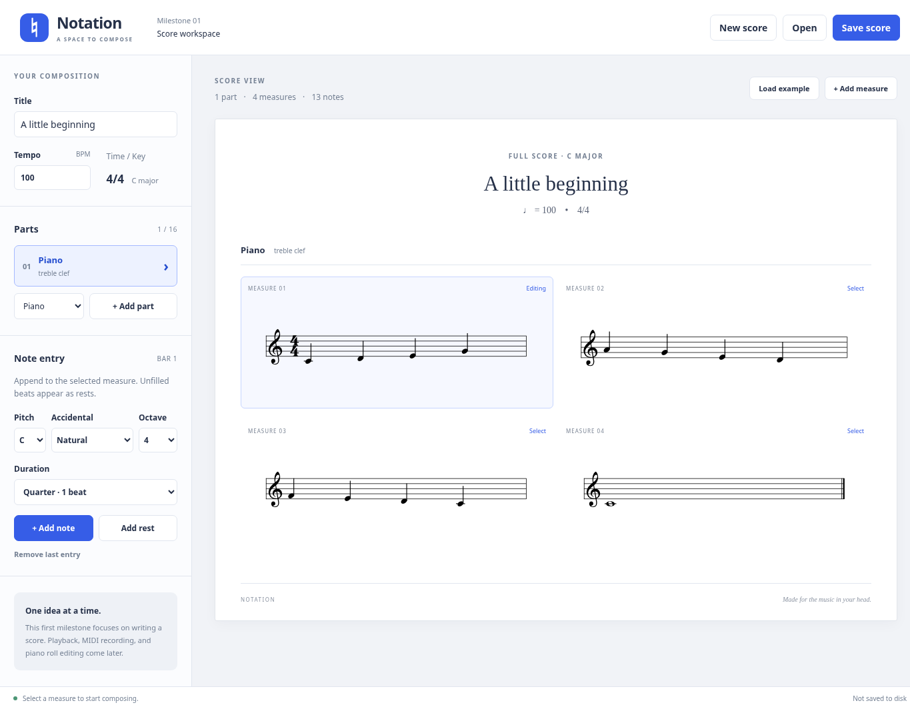

# Notation

A Windows desktop music composition workspace built with Electron, React, TypeScript, Vite, and VexFlow.

## Milestone 1

- An engraved example melody and a blank-score workflow.
- Editable title and tempo, up to 16 instrument parts and 64 measures.
- Treble/bass clefs, spelled pitches with sharps/flats/naturals, and whole through sixteenth notes/rests.
- Measure selection, append note/rest, remove last entry, and add measure.
- Native Open/Save dialogs and validated, versioned `.notation` JSON files.
- Unsaved-change confirmation before replacing a score or closing the window.
- Bundled music fonts; no network connection is needed after installation.

This milestone is a notation editor. Playback, MIDI recording/import, piano roll editing, VST3 hosting, and audio export are future work. The initial UI creates 4/4 scores in C major, with a single monophonic voice per part. Chords, ties, tuplets, dotted notes, and other key signatures are not implemented. The file model also accepts 3/4 scores.



## Launch on Windows 11

Install **Node.js 24 LTS** (including npm) from [nodejs.org](https://nodejs.org/) and [Git for Windows](https://git-scm.com/downloads/win). Restart PowerShell after installing them.

```powershell
git clone https://github.com/aapmurdock/Notation.git
cd Notation
npm ci
npm run dev
```

When reviewing the Milestone 1 PR before it is merged, run `git switch feat/milestone-1-desktop-foundation` after cloning and before `npm ci`.

`npm run dev` opens a **desktop window**, with React hot reload. Keep PowerShell open while developing; press Ctrl+C in the terminal to stop it. Node.js and the downloaded Electron binary must match your Windows architecture (x64 or ARM64). No Python, Visual Studio, audio plugins, API keys, or additional services are required for this milestone.

To run the production development build:

```powershell
npm run build
npm start
```

Build output goes to `out/`. `npm start` requires those outputs and the installed dependencies. This milestone does not generate an installer or a standalone distribution; run it from the repository using the commands above.

### First composition

1. Choose **New score**, edit the title or tempo, and press Enter or move focus to apply metadata edits.
2. Select a measure using its **MEASURE** header.
3. Choose a pitch, accidental, octave, and duration, then click **Add note** or **Add rest**. Entries append within the selected measure. Empty beats are displayed as generated rests.
4. Use **Remove last entry** to free space, select another measure when the bar is full, or choose **Add measure**.
5. Choose an instrument and **Add part** for another staff. Instruments are labels and General MIDI program metadata at this stage; they do not produce sound.
6. Choose **Save score** to write a `.notation` file. **Open** reloads it. Save currently asks for a destination each time; choose the same file to replace it.

### Troubleshooting

- If PowerShell blocks `npm.ps1`, use `npm.cmd ci` / `npm.cmd run dev`, or use Command Prompt. A global execution-policy change is unnecessary.
- Initial installation downloads the Electron binary from GitHub releases. Allow `registry.npmjs.org`, `github.com`, and `release-assets.githubusercontent.com` on your network. For an HTTPS proxy, configure the proxy normally and set `$env:ELECTRON_GET_USE_PROXY = '1'` before `npm ci`; preserve TLS verification and use your organization's trusted CA configuration when necessary.
- Port 5173 must be free. Stop another Vite instance before starting the app.
- If dependencies or outputs are stale, stop the app, run `npm ci`, then `npm run build` and `npm start`.
- `.notation` files are limited to 2 MB and validated before use. Unsupported or corrupt files produce an error without replacing the current score. Future format versions will need explicit migrations.
- Native file dialogs are available in Electron. A browser-only test harness intentionally disables Open/Save.

## Checks

```powershell
npm run check
npx playwright install chromium
npm run test:e2e
npm run test:desktop
```

`check` runs the model, engraving-adapter, file, and React tests, then type checking and a production build. `test:e2e` starts a browser harness and exercises actual VexFlow SVG engraving and editing with external network requests blocked. `test:desktop` requires a completed build and launches Electron to test the isolated bridge and a real file save/open round trip. It substitutes dialog destinations to avoid interactive prompts; it does not automate the operating system's dialog UI. Close other instances before running desktop tests.

CI runs these checks on Ubuntu and Windows. Linux desktop tests require Xvfb (`xvfb-run --auto-servernum npm run test:desktop`) and Electron's system libraries. A constrained container may also require writable XDG configuration/cache directories. `TEST_ELECTRON_NO_SANDBOX=1` is a test-only escape hatch for containers that cannot run Chromium's OS sandbox; the application itself does not disable sandboxing. Do not use that variable for normal development.

## Structure and future development

See [the architecture guide](docs/architecture.md) for the process boundaries, score format, and extension points. The shared score model owns musical data; VexFlow is an engraving adapter and does not own the document.

| Command | Purpose |
| --- | --- |
| `npm ci` | Install the locked dependencies and platform Electron binary |
| `npm run dev` | Build main/preload and launch Electron with Vite hot reload |
| `npm run build` | Type check and build main, preload, and renderer |
| `npm start` | Launch the existing production build |
| `npm test` | Run initial unit and integration tests |
| `npm run test:watch` | Watch unit tests during development |
| `npm run test:e2e` | Exercise real engraving and editing in Chromium |
| `npm run test:desktop` | Exercise the actual Electron window and file bridge |
