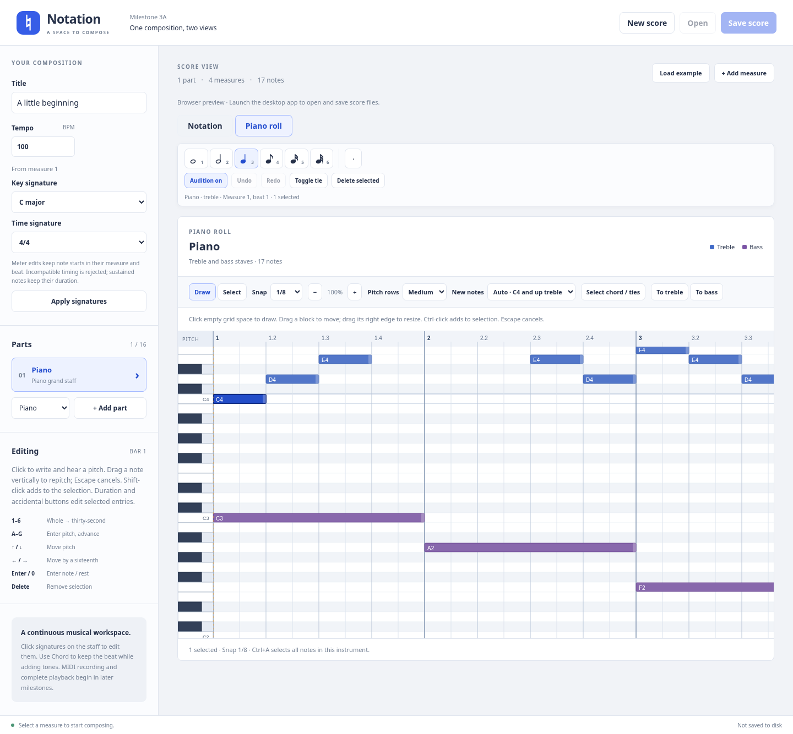

# Notation

A Windows desktop music composition workspace built with Electron, React, TypeScript, Vite, and VexFlow.

## Milestone 3A: synchronized piano roll and notation

- Switch between **Notation** and **Piano roll** on the same composition, with shared selection and undo/redo. Choose the piano-roll instrument from **Parts**. Both piano staves appear together, with staff colors and individually clickable unisons.
- Draw notes, move their pitch/time, resize their right edges, Ctrl-click multiple notes, drag a selection rectangle, and delete. Preview edits before release; **Escape** cancels a drag. IDs, velocity, and staff ownership survive edits.
- Snap at **1/4, 1/8, 1/16, or 1/32**; changing the grid never quantizes existing music. Scroll both axes; zoom the timeline from 50–400% and choose three pitch-row heights.
- New piano notes default to treble at/above **C4 (MIDI 60)** and bass below. **New notes** overrides that rule; **To treble / To bass** correct selected notes. Moving a note's pitch never switches its staff automatically.
- Reuse the short built-in piano audition for keyboard clicks, insertion, and distinct pitches during dragging. Key signatures, accidental carry, and written spellings stay consistent with sounded MIDI pitches.
- Arbitrary durations on the exact **60-tick grid at 480 PPQ**, including sustains across barlines. Notation displays tied fragments while each sustained note retains one canonical ID.
- Continuous VexFlow systems, grand staves, multiple parts, dotted notes/rests, chords, ties, signatures at measure boundaries, native Open/Save, and unsaved-change protection remain available. Click any notation staff directly; the **Active Staff** sidebar control is removed.
- Version **4** `.notation` saves, with explicit migrations from versions **1–3** that preserve musical data. Save older scores to a new filename during evaluation; earlier app versions cannot open version 4 files.

This branch stops at **Milestone 3A**. Full playback/transport, metronome, MIDI connectivity/recording, instrument libraries, VST3 hosting, and WAV/MP3 export remain future work.



### Current editing limits

Each staff supports one rhythmic voice with chords sharing start and duration. Independent overlapping voices are rejected explicitly and atomically. **Only selected notes are edited**: use **Select chord / ties** before changing a chord's shared rhythm or moving a tied phrase together. Incompatible edits retain the original score and explain the problem. Notation entry and duration buttons retain the existing within-bar workflow; use the piano roll to create/resize sustained notes across bars.

Piano roll shows notes; rests remain editable in notation. It supports the existing spelling range, including C-flat0 through G9 (sounded MIDI 11–127); lower MIDI pitches, tuplets, double dots/accidentals, and cross-staff notation are not included. Roll dragging does not automatically scroll at viewport edges; scroll/zoom to expose the destination first. Display preferences are session state, not saved musical data. A sustained duration without a single matching notation glyph keeps the last toolbar insertion duration until a duration button is explicitly chosen. There is no installer yet.

## Launch on Windows 11

Install **Node.js 24 LTS** (including npm) from [nodejs.org](https://nodejs.org/) and [Git for Windows](https://git-scm.com/downloads/win). Restart PowerShell after installing them.

```powershell
git clone https://github.com/aapmurdock/Notation.git
cd Notation
npm ci
npm run dev
```

When reviewing the Milestone 3A PR before it is merged, run `git switch feat/milestone-3a-piano-roll` after cloning and before `npm ci`.

`npm run dev` opens a **desktop window**, with React hot reload. Keep PowerShell open while developing; press Ctrl+C in the terminal to stop it. Node.js and the downloaded Electron binary must match your Windows architecture (x64 or ARM64). No Python, Visual Studio, audio plugins, API keys, or additional services are required for this milestone.

To run the production development build:

```powershell
npm run build
npm start
```

Build output goes to `out/`. `npm start` requires those outputs and the installed dependencies. This milestone does not generate an installer or a standalone distribution; run it from the repository using the commands above.

### Testing this branch in an existing Windows 11 checkout

Stop the application, open PowerShell in your Notation directory, and run:

```powershell
git fetch origin
git switch feat/milestone-3a-piano-roll
npm ci
npm run dev
```

### Manual piano-roll evaluation on Windows 11

1. Start the desktop app, inspect the example in **Notation**, then choose **Piano roll**. Both piano staves appear as note blocks. Switch back and forth; selection, document changes, and the approximate editing location should survive. Use the Parts list to show a different instrument; clicking another part's notation immediately changes editing context.
2. Start **New score**, open Piano roll, select a quarter duration and **1/16** snap. Click an empty grid cell near C4: it should add and audition the intended note. Click a keyboard key to audition it. Check Windows output volume if silent; **Audition off** mutes previews.
3. Drag a block vertically and horizontally. It should preview snapped pitch/time and sound each new semitone once. Release to commit; Escape before release cancels. A click or small jitter should select without moving. Drag across C4: an existing bass note must remain assigned to bass. Use **To treble / To bass** to reassign explicitly.
4. Drag the light right edge to resize. Select **1/32** and duration **6** to create a 60-tick note. Test all four snap values; existing fine positions/durations should stay unchanged when the grid changes. At 50%, 100%, 200%, and 400% zoom, check insertion, movement, and resizing. Change pitch-row size and scroll both axes; keyboard pitches and ruler beats must align with the grid. Repeat at Windows 100%/125% display scaling.
5. Ctrl-click two blocks, move or delete the group, then Ctrl+Z / Ctrl+Y. Choose **Select** (V), click blank space to deselect, then drag a rectangle around notes. **Draw** (D) returns to insertion. Arrow keys move selected notes by the snap value/semitone; Shift+Up/Down moves an octave. With no selection, arrows position the editing cursor and Enter inserts. Tab/Enter also operate note blocks, resize edges, and keyboard keys.
6. Insert a quarter just before a barline using 1/32 snap, or extend a note's right edge across the bar. Switch to Notation: tied fragments must span the barline, and returning to the roll must show one block. Narrow the window to check ties across system breaks. Select/delete any engraved fragment: it edits the original sustained event.
7. Add a chord by clicking different pitches at the same start with equal durations. Try moving/resizing one tone into an incompatible overlap: the edit should be rejected with no data loss. Use **Select chord / ties** to select related notes, then move/resize together. Existing explicit ties remain attached to their original IDs. A treble/bass unison at the same time gets separate upper/lower click targets.
8. Choose G major or D minor in the sidebar, or edit a notation signature directly. F in G major should appear at F-sharp's chromatic roll row unless explicitly natural. Edit a written accidental in notation and check its roll pitch. Roll transposition preserves unedited sounding pitches even when accidental carry changes. Change a measure to **6/8**: the ruler uses eighth-note beats and dotted-quarter group accents; measure boundaries and 1/32 timing remain exact.
9. Click treble, bass, and another instrument's notation without using the Parts list first. Insert, drag, change duration, and delete; only the selected notes/staff should change. **Select chord / ties** is now required before a chord-wide duration edit. Check dots, explicit rests, signatures, and continuous barline alignment as before.
10. Save a score containing both piano staves, chords, explicit ties, a cross-bar sustain, thirty-second notes, accidentals, local signatures, and another part. Open a new score, reopen the saved file, inspect both views, and save again. Notes, IDs, velocities, timing, and ownership should remain exact. Open copies of older version 1/2/3 files and save under a new name. Cancel unsaved-change prompts and try an invalid file to confirm the current document survives.

### Additional notation regression checks

1. **Check the score foundation.** Inspect the example, resize the window, and add Violin/Cello. Staff lines remain continuous; barlines and beats align across parts; each piano system has one brace and one clef per staff. Both piano staves accept independent music.
2. **Hear mouse entry.** Start **New score**, choose a quarter, and click the bottom treble line (**E4**, MIDI 64). Click the bass C3 position (three diatonic steps above its bottom G2 line; MIDI 48). Each successful note insertion should sound once, and rests should stay silent. **Audition off** mutes previews. Check your Windows output device and application volume if silent.
3. **Drag and cancel.** Click a notehead and drag vertically. The blue preview snaps to lines/spaces and ledger lines, and sounds only when its pitch changes. Horizontal motion keeps the original beat. Release to commit; duration, ID, and beat stay unchanged. Repeat and press Escape before release: the original pitch must remain. Move outside the staff while holding the mouse to check pointer capture. Window focus loss also cancels.
4. **Check zoom and scroll.** Repeat insertion/dragging in a short window requiring scrolling, at Windows display scaling of 100% and 125%. Focus Title first, then enter notes. Preview and inserted pitch must agree without a focus-induced viewport jump. Desktop tests additionally exercise 100% and 125% application zoom.
5. **Edit signatures directly.** Click the printed **4/4**, choose 3/4 or 6/8, and Apply. Click the key signature or **K** target above a staff. Choose G major: entered F4 should now sound F♯4 (MIDI 66). Choose D minor: B should sound B♭. Sidebar controls reflect the active measure's signatures. Tab/Enter can operate signature targets; Escape/Cancel dismisses the contextual editor.
6. **Make a local change.** Use **K/T** above measure 2 or later. Changes apply from that boundary until the next change of the same type, across every part. Earlier measures retain their signatures. Narrow the score until measure 3 starts a new system in C major: K and T must stay distinct and open their respective editors on both staves. Choose a measure header or staff to show its signatures in the sidebar. Applying the sidebar controls uses that selected measure.
7. **Protect existing music.** Enter a whole note in measure 1 of 4/4, then try changing it to 3/4: the editor should explain which measure will not fit and retain the score. For valid meter edits, notes keep their measure and offset from its start; downstream absolute ticks adjust to the new bar lengths. Key edits preserve written pitch spelling, while notes following the key sound according to the new signature.
8. **Edit notes and rests.** Select an entry and use duration buttons or **1–6**. Toggle the dot (**.**) for a dotted duration. A quarter becomes 720 ticks (1½ quarter beats); a dotted sixteenth is 180 ticks. Overlaps and barline crossings are rejected atomically. Dotted rests work the same way. Toolbar controls affect the selection when one exists and future entry otherwise. **N** clears selection and moves past occupied time for continued writing.
9. **Build chords.** Toggle **Chord** (**H**) before entering tones. The caret stays at the same beat; type C, E, G or click their staff positions at that beat. Each tone has its own identity and pitch, and VexFlow engraves one chord. Turn Chord off and press Right or N to move onward. To add to an existing chord, select a tone and enable Chord. Choose **Select chord / ties** before changing the shared chord duration; deleting or dragging a tone affects only that selected tone.
10. **Edit accidentals.** Select a note and choose Sharp, Flat, Natural, or **Key**. Natural explicitly cancels the key or a carried accidental; Key removes an explicit override and follows the key/earlier accidental in that bar. These controls also work for future notes with no selection. Explicit accidentals carry for the same written pitch and octave in the same staff until the next barline.
11. **Tie notes.** Enter adjacent notes of the same written and sounded pitch, select the earlier one, and choose **Toggle tie** (**T**). Repeat to remove it. Ties can cross barlines and system breaks. They connect existing notes; they do not create new notes. Remove an affected tie before an edit that would make its pitches or times incompatible. Deleting a tie target also removes its incoming tie.
12. **Select multiple entries.** Shift-click individual noteheads/rests. Delete removes the selection as one edit; duration/accidental changes apply to the selection (select all chord tones explicitly before changing their rhythm). Adjacent chord seconds remain independently selectable. Selection is available across piano staves and parts; piano-roll marquee selection is also available.
13. **Undo and redo.** Use Ctrl+Z / Ctrl+Y or the buttons. A drag, chord duration edit, batch delete, or signature change takes one undo step. A new edit clears redo. Undoing back to the saved document clears the unsaved indicator; opening/creating a score clears history. Title/tempo typing retains normal text-field shortcuts.
14. **Save and reopen.** Save a score with both piano staves, chords, dots, accidentals, ties, and local signatures. Open it again and verify pitches, durations, part labels, signatures, and tie curves. Open copies of older version 1/2/3 files; music remains on its original staves. Save to a **new filename** for evaluation: version 4 files cannot be opened by older milestones.
15. **Check protection.** Cancel unsaved-change confirmations when creating/opening/closing. Open an invalid file and confirm the current score survives. Editing controls, including signatures, are disabled during native file operations.

Mouse x positions snap to the selected duration's grid. Existing notes/rests are selected rather than overwritten. Deleted entries leave gaps without shifting later music. Notation duration buttons require unoccupied time within the bar; use the piano roll for cross-bar sustains or enter separate tied notes.

### Notation keyboard reference (with score or toolbar focus)

| Key | Action |
| --- | --- |
| `1`, `2`, `3`, `4`, `5`, `6` | Whole, half, quarter, eighth, sixteenth, thirty-second; edits selection when present |
| `.` | Toggle dotted duration |
| `H` | Toggle chord entry (hold the beat for more tones) |
| `T` | Add/remove ties from selected notes to adjacent matching notes |
| `A`–`G` | Enter pitch in the pending octave |
| Up / Down | Repitch a single selected note, or move the pending pitch |
| Left / Right | Clear selection and move the caret by one sixteenth |
| Enter / `0` | Insert pending note/rest / explicit rest |
| `R` | Toggle rest entry |
| `+`, `-`, `=` | Sharp, flat, explicit natural |
| Delete / Backspace | Delete selected entries |
| Ctrl+Z / Ctrl+Y | Undo / redo (Ctrl+Shift+Z also redoes) |
| `N` / Escape | Continue writing past occupied time / select mode; Escape cancels a drag |
| Shift-click | Toggle an entry in the selection |
| Tab, Enter | Focus and activate measure/note/signature/toolbar controls |

Typing in metadata fields does not invoke score shortcuts. Instrument choices remain General MIDI metadata; the single built-in piano is used only for audition.

### Troubleshooting

- If PowerShell blocks `npm.ps1`, use `npm.cmd ci` / `npm.cmd run dev`, or use Command Prompt. A global execution-policy change is unnecessary.
- Initial installation downloads the Electron binary from GitHub releases. Allow `registry.npmjs.org`, `github.com`, and `release-assets.githubusercontent.com` on your network. For an HTTPS proxy, configure the proxy normally and set `$env:ELECTRON_GET_USE_PROXY = '1'` before `npm ci`; preserve TLS verification and use your organization's trusted CA configuration when necessary.
- Port 5173 must be free. Stop another Vite instance before starting the app.
- If dependencies or outputs are stale, stop the app, run `npm ci`, then `npm run build` and `npm start`.
- `.notation` files are limited to 2 MB and validated before use. Unsupported or corrupt files produce an error without replacing the current score. Version 1, 2, and 3 files migrate to version 4 on load; unknown versions are rejected.
- Native file dialogs are available in Electron. A browser-only test harness intentionally disables Open/Save.

## Checks

```powershell
npm run check
npx playwright install chromium
npm run test:e2e
npm run test:desktop
```

`check` runs the model, engraving-adapter, file, and React tests, then type checking and a production build. `test:e2e` additionally covers piano-roll insertion/movement/resizing at multiple zoom levels, every snap resolution, stable-pitch audition, marquee/multiple selection, staff ownership, unisons, cross-bar tied engraving, thirty-second flags/beams/rests, and shared history. It exercises real continuous VexFlow paths, clef placement, responsive wrapping, grand staff/part alignment, direct entry, Web Audio MIDI frequencies, snapped dragging/cancellation, repeated-pitch suppression, signature editors, chords, dots, ties, selections, undo/redo, and rhythm boundaries. The layout test blocks external requests to verify offline fonts. `test:desktop` requires a completed build and launches Electron to test the isolated bridge and a real save/open round trip with independently entered treble/bass music, version 1 migration, dragging at 100%/125% zoom, and exact restoration of chords/dots/ties/local signatures. The desktop suite also edits the roll at 100%/125% native zoom and saves/reopens exact thirty-second positions, cross-bar sustains, chord/tie IDs, velocity, and staff ownership. Model tests verify versions 2/3 migration. It substitutes dialog destinations to avoid interactive prompts; it does not automate the operating system's dialog UI. Close other instances before running desktop tests.

CI runs these checks on Ubuntu and Windows. Linux desktop tests require Xvfb (`xvfb-run --auto-servernum npm run test:desktop`) and Electron's system libraries. A constrained container may also require writable XDG configuration/cache directories. `TEST_ELECTRON_NO_SANDBOX=1` is a test-only escape hatch for containers that cannot run Chromium's OS sandbox; the application itself does not disable sandboxing. Do not use that variable for normal development.

## Structure and future development

See [the architecture guide](docs/architecture.md) for the process boundaries, score format, and extension points. The shared score model owns musical data; VexFlow is an engraving adapter and does not own the document.

| Command | Purpose |
| --- | --- |
| `npm ci` | Install the locked dependencies and platform Electron binary |
| `npm run dev` | Build main/preload and launch Electron with Vite hot reload |
| `npm run build` | Type check and build main, preload, and renderer |
| `npm start` | Launch the existing production build |
| `npm test` | Run initial unit and integration tests |
| `npm run test:watch` | Watch unit tests during development |
| `npm run test:e2e` | Exercise real engraving and editing in Chromium |
| `npm run test:desktop` | Exercise the actual Electron window and file bridge |
