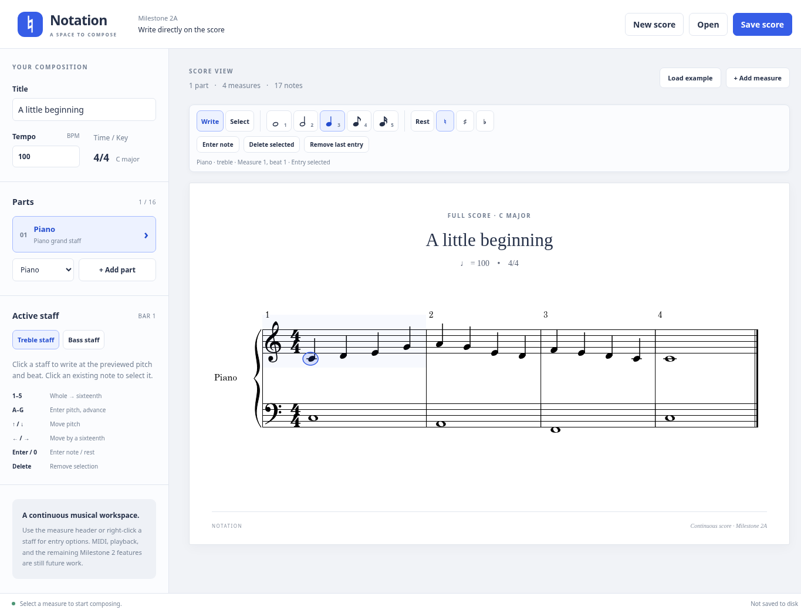

# Notation

A Windows desktop music composition workspace built with Electron, React, TypeScript, Vite, and VexFlow.

## Milestone 2A: continuous staff layout and interactive entry

- Consecutive measures engraved on continuous staff lines, with standard barlines and automatic system wrapping as the window changes width.
- Piano grand staves with a brace, treble and bass clefs, and independent music in each staff. Other instruments remain separate parts with vertically aligned barlines and beats.
- Direct mouse entry: hover to preview a pitch and snapped beat, then click to insert. Click an existing note or explicit rest to select it, then use Delete or **Delete selected**.
- A persistent compact notation toolbar plus a contextual duration/rest popover above the selected measure.
- Whole, half, quarter, eighth, and sixteenth notes/rests; keyboard pitch entry and automatic advancement through measures.
- Existing metadata editing, multiple instruments, native Open/Save, and unsaved-change protection.
- Version 2 `.notation` files, with automatic migration of Milestone 1 files. Notes retain their IDs, pitches, durations, and tick positions on their original clef; a legacy piano gains an empty companion staff.
- Bundled engraving fonts for offline use.

This branch stops at Milestone 2A. Playback, MIDI recording/import, piano roll editing, VST3 hosting, and audio export remain future work. Each staff supports one monophonic voice. Chords, ties, tuplets, dotted notes, and other key signatures are not implemented. The UI creates 4/4 scores in C major; the model also accepts 3/4 files.



## Launch on Windows 11

Install **Node.js 24 LTS** (including npm) from [nodejs.org](https://nodejs.org/) and [Git for Windows](https://git-scm.com/downloads/win). Restart PowerShell after installing them.

```powershell
git clone https://github.com/aapmurdock/Notation.git
cd Notation
npm ci
npm run dev
```

When reviewing the Milestone 2A PR before it is merged, run `git switch feat/milestone-2a-continuous-entry` after cloning and before `npm ci`.

`npm run dev` opens a **desktop window**, with React hot reload. Keep PowerShell open while developing; press Ctrl+C in the terminal to stop it. Node.js and the downloaded Electron binary must match your Windows architecture (x64 or ARM64). No Python, Visual Studio, audio plugins, API keys, or additional services are required for this milestone.

To run the production development build:

```powershell
npm run build
npm start
```

Build output goes to `out/`. `npm start` requires those outputs and the installed dependencies. This milestone does not generate an installer or a standalone distribution; run it from the repository using the commands above.

### Testing this branch in an existing Windows 11 checkout

Stop the application, open PowerShell in your Notation directory, and run:

```powershell
git fetch origin
git switch feat/milestone-2a-continuous-entry
npm ci
npm run dev
```

### Manual evaluation on Windows 11

1. **Inspect the example.** It now contains a treble melody and bass accompaniment under one Piano part. Verify continuous five-line staves, barlines through the grand staff, one brace per system, and clefs at each system start. There should be no separate measure cards.
2. **Resize the window.** Make it wide, then narrow. Measures should reflow into additional systems without changing notes or timing. A single unusually dense bar can scroll horizontally instead of crushing its notation.
3. **Align instruments.** Add Violin or Cello. Corresponding barlines and beats should align vertically across all parts in each system. Adding Piano creates a new two-staff part, not two unrelated instruments.
4. **Start a blank score.** Choose **New score**. Edit the title and tempo; press Enter or move focus to apply those edits.
5. **Try direct pitch entry.** Select **Quarter duration**. Hover near the bottom treble line: the blue preview should say **E4**. Click to insert. Hover in a space or on a different line and check that the preview changes by one diatonic pitch for each half staff space. Middle C (**C4**) appears on a ledger line just below treble.
6. **Enter bass music.** Hover over the bottom bass line (**G2**), or three diatonic positions above it (**C3**). Click to insert. Confirm that treble notes remain unchanged and bass has its own insertion position.
7. **Change duration nearby.** Right-click a blank area of the desired staff/measure, or click its measure-number region just above the staff. Choose a duration in the popover. It closes and returns keyboard focus to the score. The same controls remain available in the persistent toolbar while scrolling. Escape closes the popover; Tab reaches its buttons.
8. **Add rests.** Toggle **Rest entry**, then click a beat, or press **0** while the score has focus to insert a rest of the selected duration. Turn Rest off to return to notes. Blank beats are filled with display-only rests automatically.
9. **Write repeatedly with the keyboard.** Select an empty measure and close the popover. Press **3** for quarters, then **C, D, E, F**. The caret should advance by a quarter after each note and land at the beginning of the next measure. Press **4** for eighths or **5** for sixteenths without leaving the score. Up/Down changes the pending octave/pitch; Enter writes it. Sidebar staff buttons switch the target staff and return focus to the score.
10. **Check boundaries.** At beat 4 of 4/4, choose a half note and try inserting it. The application should explain that it crosses a barline and leave the score unchanged. A full measure advances the keyboard caret to the next available position. At the end of the score, use **Add measure** to continue.
11. **Select and delete.** Click the head of an existing note or an explicit rest, then press Delete/Backspace or **Delete selected**. The deleted duration becomes implicit rest space. Other notes keep their original timing. **Select entries** lets you reposition the caret by clicking without writing. **Remove last entry** still removes the last entry of the currently selected staff and measure.
12. **Save and reopen.** Enter music in both piano staves and another instrument; choose **Save score**, then **New score**, then **Open** the saved file. Check both piano staves, part labels, durations, and measure positions. Save still asks for a destination each time.
13. **Check old files.** Open a copy of a Milestone 1 `.notation` file. Its music should remain on the original clef; piano receives the other empty staff. Save to a **new filename** during evaluation: new saves use version 2 and cannot be opened by Milestone 1.
14. **Check protection against losing work.** Make an edit, then choose New/Open/Load example or close the window. Cancel the confirmation and verify the composition remains. Open an invalid file and verify it reports an error without replacing your score.

For the Windows pitch regression, repeat the mouse-entry checks in a short window that requires scrolling, at both 100% and 125% display scaling. Focus the Title field first, then hover and click the engraved treble bottom line (E4) or bass C3 position. The preview and inserted pitch must agree, and returning focus to the score must not jump the viewport. The desktop suite also checks scrolled entry at 100% and 125% application zoom and saves traces for diagnosis.

Horizontal clicks snap to a grid based on the selected duration. The preview identifies the exact insertion pitch and beat before the click. Existing notes/rests are selected rather than overwritten; occupied time and barline overruns are rejected. Changing duration affects new entries, not the duration of a selected note. Deleted entries leave a gap rather than shifting later music.

### Keyboard reference (with score or toolbar focus)

| Key | Action |
| --- | --- |
| `1`, `2`, `3`, `4`, `5` | Whole, half, quarter, eighth, sixteenth |
| `A`–`G` | Enter that pitch in the pending octave and advance |
| Up / Down | Move the pending pitch by one diatonic position |
| Left / Right | Move the insertion caret by one sixteenth |
| Enter | Insert the pending note/rest at the caret |
| `R` | Toggle rest entry |
| `0` | Insert a rest of the selected duration |
| `+`, `-`, `=` | Sharp, flat, natural for subsequent notes |
| Delete / Backspace | Delete the selected entry |
| `N` / Escape | Write mode / select mode (Escape also closes the popover) |
| Tab, Enter | Focus and activate accessible measure/note/toolbar controls |

Typing in the title and tempo fields does not invoke note-entry shortcuts. Instrument choices remain General MIDI labels/metadata; this milestone does not produce sound or connect to MIDI hardware.

### Troubleshooting

- If PowerShell blocks `npm.ps1`, use `npm.cmd ci` / `npm.cmd run dev`, or use Command Prompt. A global execution-policy change is unnecessary.
- Initial installation downloads the Electron binary from GitHub releases. Allow `registry.npmjs.org`, `github.com`, and `release-assets.githubusercontent.com` on your network. For an HTTPS proxy, configure the proxy normally and set `$env:ELECTRON_GET_USE_PROXY = '1'` before `npm ci`; preserve TLS verification and use your organization's trusted CA configuration when necessary.
- Port 5173 must be free. Stop another Vite instance before starting the app.
- If dependencies or outputs are stale, stop the app, run `npm ci`, then `npm run build` and `npm start`.
- `.notation` files are limited to 2 MB and validated before use. Unsupported or corrupt files produce an error without replacing the current score. Version 1 files migrate to version 2 on load; other versions are rejected.
- Native file dialogs are available in Electron. A browser-only test harness intentionally disables Open/Save.

## Checks

```powershell
npm run check
npx playwright install chromium
npm run test:e2e
npm run test:desktop
```

`check` runs the model, engraving-adapter, file, and React tests, then type checking and a production build. `test:e2e` exercises real continuous VexFlow paths, responsive wrapping, grand staff/part alignment, direct-pitch previews, independent staff entry, deletion, and keyboard rhythm boundaries. The layout test blocks external requests to verify offline fonts. `test:desktop` requires a completed build and launches Electron to test the isolated bridge and a real save/open round trip with independently entered treble/bass music, plus version 1 migration. It substitutes dialog destinations to avoid interactive prompts; it does not automate the operating system's dialog UI. Close other instances before running desktop tests.

CI runs these checks on Ubuntu and Windows. Linux desktop tests require Xvfb (`xvfb-run --auto-servernum npm run test:desktop`) and Electron's system libraries. A constrained container may also require writable XDG configuration/cache directories. `TEST_ELECTRON_NO_SANDBOX=1` is a test-only escape hatch for containers that cannot run Chromium's OS sandbox; the application itself does not disable sandboxing. Do not use that variable for normal development.

## Structure and future development

See [the architecture guide](docs/architecture.md) for the process boundaries, score format, and extension points. The shared score model owns musical data; VexFlow is an engraving adapter and does not own the document.

| Command | Purpose |
| --- | --- |
| `npm ci` | Install the locked dependencies and platform Electron binary |
| `npm run dev` | Build main/preload and launch Electron with Vite hot reload |
| `npm run build` | Type check and build main, preload, and renderer |
| `npm start` | Launch the existing production build |
| `npm test` | Run initial unit and integration tests |
| `npm run test:watch` | Watch unit tests during development |
| `npm run test:e2e` | Exercise real engraving and editing in Chromium |
| `npm run test:desktop` | Exercise the actual Electron window and file bridge |
